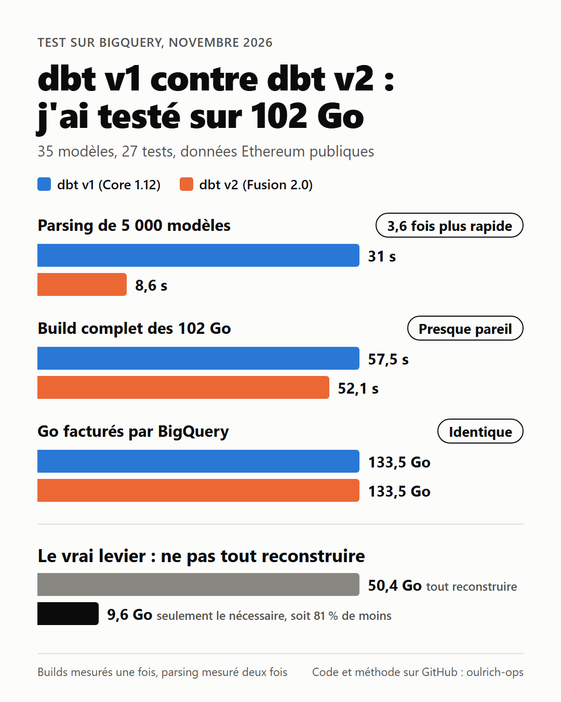

# dbt v1 contre dbt v2 (Fusion) sur 102 Go de données Ethereum dans BigQuery

Ce dépôt contient tout le nécessaire pour refaire le test chez vous : le projet dbt, les scripts de chargement, les scripts de mesure et les résultats obtenus.



## Ce que le test mesure

Deux questions différentes, à ne pas mélanger :

1. Le moteur v2 est-il plus rapide que le moteur v1 ? (parsing, temps total d'un build)
2. Combien coûte un build quand on reconstruit tout, par rapport à un build qui ne reconstruit que le nécessaire ?

Avec BigQuery, c'est l'entrepôt qui exécute le SQL, pas dbt. Si le SQL est le même, le temps de requête et la facture sont les mêmes quel que soit le moteur. Le test le confirme.

## Résultats obtenus

Test réalisé le 11 novembre 2026 avec dbt Core 1.12.6, dbt Fusion 2.0.11, sous Windows 11.

| Mesure | dbt v1 | dbt v2 | Écart |
|---|---|---|---|
| Parsing du projet, 35 modèles | 3,79 s | 0,66 s | v2 5,7 fois plus rapide |
| Parsing à froid, 5 000 modèles | 31 s | 8,6 s | v2 3,6 fois plus rapide |
| Parsing à chaud, 5 000 modèles | 8,2 s | 8,0 s | équivalent |
| Build complet, 102 Go | 57,5 s | 52,1 s | v2 9 % plus rapide |
| Go facturés, build complet | 133,5 | 133,5 | identique |
| Rebuild sans aucun changement | 60,0 s | 55,5 s | v2 8 % plus rapide |
| Go facturés, rebuild | 49,4 | 49,4 | identique |

Arrivée d'un jour de données sur une seule source (token_transfers) :

| Stratégie | Moteur | Noeuds exécutés | Temps | Go facturés |
|---|---|---|---|---|
| Tout reconstruire (`dbt build`) | v2 | 64 | 62,0 s | 50,4 |
| Seulement le nécessaire (sélection par état) | v1 | 12 | 44,3 s | 9,6 |

Ce qu'il faut retenir :

- Le parsing est nettement plus rapide en v2, mais on est à 3,6 fois sur 5 000 modèles, pas à 10 fois.
- Dès que la v1 utilise son cache (parsing partiel), l'écart de parsing disparaît.
- Le temps de build est presque le même. Le gain de 5 secondes vient du démarrage et du parsing.
- La facture BigQuery est strictement identique entre v1 et v2.
- Le vrai levier de coût est de ne pas tout reconstruire : 81 % de Go facturés en moins dans ce test, et cela fonctionne déjà en v1.

Les chiffres bruts sont dans `results/metrics.csv`.

## Limites du test

- Les builds n'ont été lancés qu'une seule fois par moteur. Un écart de 8 à 9 % sur une seule mesure n'est pas une preuve.
- Le parsing sur 5 000 modèles a été mesuré deux fois par moteur, avec des résultats stables.
- Les 5 000 modèles sont générés automatiquement et sont très simples. Un vrai projet avec des macros et des packages peut se comporter autrement.
- Une seule machine, sous Windows.
- Le build complet a consommé plus de secondes de slot en v2 (5 376) qu'en v1 (3 483) pour le même SQL. Une seule mesure ne permet pas de dire si cela vient du moteur ou de BigQuery.
- dbt State (la fonctionnalité de la plateforme dbt) n'a pas été testé ici. La sélection par état utilisée est celle disponible en ligne de commande.

## Le projet

| Élément | Détail |
|---|---|
| Données | Copie d'une partie du dataset public `bigquery-public-data.crypto_ethereum` |
| Tables brutes | transactions, token_transfers, logs, blocks, tokens |
| Volume | 24 jours, du 2024-01-01 au 2024-01-24, soit 102 Go |
| Modèles | 35 : 5 staging, 8 intermédiaires, 6 core, 16 marts |
| Tests | 27 tests et 2 seeds |
| Datasets cibles | `eth_v1` pour dbt v1, `eth_v2` pour dbt v2 |

Le projet a quatre branches indépendantes (transactions, token_transfers, logs, blocks). Quand une seule source reçoit des données, les autres branches n'ont pas besoin d'être reconstruites.

## Reproduire le test

Les commandes sont écrites pour PowerShell sous Windows.

### Étape 1. Prérequis

- Un projet Google Cloud avec la facturation activée.
- Les outils `gcloud` et `bq` installés et connectés à ce projet.
- Python 3.12.
- Un compte de service pour dbt, avec son fichier de clé JSON.

Coût à prévoir : le stockage de 102 Go coûte environ 2 dollars par mois. L'ensemble des scénarios lit environ 600 Go. Le quota gratuit de BigQuery est de 1 To par mois.

### Étape 2. Donner les droits au compte de service

Le compte de service a besoin de trois rôles. Le troisième est exigé par dbt v2 seulement.

```powershell
$projet = "mon-projet-gcp"
$compte = "serviceAccount:mon-compte@mon-projet-gcp.iam.gserviceaccount.com"
gcloud projects add-iam-policy-binding $projet --member=$compte --role="roles/bigquery.dataEditor"
gcloud projects add-iam-policy-binding $projet --member=$compte --role="roles/bigquery.jobUser"
gcloud projects add-iam-policy-binding $projet --member=$compte --role="roles/bigquery.readSessionUser"
```

### Étape 3. Récupérer le projet et le configurer

```powershell
git clone https://github.com/oulrich-ops/dbt-v1-vs-v2-bigquery-benchmark.git
cd dbt-v1-vs-v2-bigquery-benchmark
Copy-Item env.example.ps1 env.local.ps1
```

Ouvrez `env.local.ps1` et renseignez l'identifiant de votre projet Google Cloud et le chemin de votre fichier de clé. Ce fichier n'est pas envoyé sur git.

### Étape 4. Installer dbt v1

```powershell
python -m venv .venv
.\.venv\Scripts\pip install dbt-core dbt-bigquery
.\.venv\Scripts\dbt.exe --version
```

### Étape 5. Installer dbt v2

```powershell
irm https://public.cdn.getdbt.com/fs/install/install.ps1 | iex
& "$env:USERPROFILE\.local\bin\dbt.exe" --version
```

Si une ancienne version est déjà installée, mettez-la à jour :

```powershell
& ([scriptblock]::Create((irm https://public.cdn.getdbt.com/fs/install/install.ps1))) -Update
```

Les deux versions s'appellent `dbt`. Pour éviter toute confusion, les scripts utilisent le chemin complet de chaque exécutable.

### Étape 6. Charger les données

Commencez par une estimation, qui ne coûte rien :

```powershell
.\scripts\load_raw.ps1 -Start 2024-01-01 -End 2024-01-24 -DryRun
```

Puis lancez le chargement. Il lit environ 110 Go et dure deux à trois minutes.

```powershell
.\scripts\load_raw.ps1 -Start 2024-01-01 -End 2024-01-24
```

Le script crée les datasets `eth_raw`, `eth_v1` et `eth_v2` dans la région US. Vous pouvez le relancer sans créer de doublons.

### Étape 7. Build complet avec chaque moteur

Ne lancez jamais deux mesures en même temps.

```powershell
.\scripts\bench.ps1 -Engine v1 -Scenario C_full_refresh -DbtArgs "build --full-refresh"
.\scripts\bench.ps1 -Engine v2 -Scenario C_full_refresh -DbtArgs "build --full-refresh"
```

Chaque exécution est enregistrée dans `results\runs.csv`.

### Étape 8. Enregistrer l'état de référence

Cet état sert plus tard à ne reconstruire que le nécessaire.

```powershell
. .\env.local.ps1
.\.venv\Scripts\dbt.exe source freshness --target v1 --target-path target_v1 --profiles-dir .
New-Item -ItemType Directory -Force state_v1
Copy-Item target_v1\manifest.json, target_v1\sources.json state_v1\ -Force
```

### Étape 9. Parsing du projet

```powershell
.\scripts\bench.ps1 -Engine v1 -Scenario B_parse -DbtArgs "parse"
.\scripts\bench.ps1 -Engine v2 -Scenario B_parse -DbtArgs "parse"
```

### Étape 10. Parsing sur 5 000 modèles

Le temps de parsing dépend du nombre de modèles, pas du volume de données. Ce projet généré ne lit aucune table et ne coûte rien.

```powershell
python scripts\gen_synthetic_project.py --models 5000
cd synthetic_project

# dbt v1, à froid
Remove-Item target -Recurse -Force -ErrorAction SilentlyContinue
Measure-Command { ..\.venv\Scripts\dbt.exe parse --profiles-dir . | Out-Host }

# dbt v1, à chaud (relancer sans rien supprimer)
Measure-Command { ..\.venv\Scripts\dbt.exe parse --profiles-dir . | Out-Host }

# dbt v2, à froid
Remove-Item target -Recurse -Force -ErrorAction SilentlyContinue
Measure-Command { & "$env:USERPROFILE\.local\bin\dbt.exe" parse --profiles-dir . | Out-Host }

cd ..
```

Gardez bien `| Out-Host` : sans lui, une erreur passe inaperçue et la durée affichée est fausse.

### Étape 11. Rebuild sans aucun changement

```powershell
.\scripts\bench.ps1 -Engine v1 -Scenario D_rebuild -DbtArgs "build"
.\scripts\bench.ps1 -Engine v2 -Scenario D_rebuild -DbtArgs "build"
```

### Étape 12. Nouvelles données sur une seule source

Ajoutez un jour de données sur `token_transfers` seulement :

```powershell
.\scripts\load_raw.ps1 -Start 2024-01-25 -End 2024-01-25 -Sources token_transfers
```

Premier cas, tout reconstruire :

```powershell
.\scripts\bench.ps1 -Engine v2 -Scenario E_new_data_build_complet -DbtArgs "build"
```

Deuxième cas, ne reconstruire que ce qui dépend de la source mise à jour :

```powershell
.\.venv\Scripts\dbt.exe source freshness --target v1 --target-path target_v1 --profiles-dir .
.\scripts\bench.ps1 -Engine v1 -Scenario E_new_data_selectif -DbtArgs "build --select state:modified+ source_status:fresher+ --state state_v1"
```

### Étape 13. Récupérer les chiffres

Attendez une minute après le dernier build, puis :

```powershell
.\scripts\collect.ps1
```

Le script lit l'historique des jobs BigQuery et ajoute à chaque exécution le nombre de jobs, les Go facturés et les secondes de slot. Le résultat est écrit dans `results\metrics.csv`.

### Étape 14. Nettoyer

Pour arrêter les frais de stockage :

```powershell
bq rm -r -f mon-projet-gcp:eth_raw
bq rm -r -f mon-projet-gcp:eth_v1
bq rm -r -f mon-projet-gcp:eth_v2
```

## Contenu du dépôt

| Chemin | Rôle |
|---|---|
| `models/` | Les 35 modèles dbt |
| `seeds/` | Stablecoins et signatures d'événements connues |
| `macros/max_loaded_date.sql` | Calcule la dernière date chargée d'un modèle incrémental |
| `scripts/load_raw.ps1` | Copie les données publiques dans votre projet |
| `scripts/bench.ps1` | Lance une commande dbt chronométrée |
| `scripts/collect.ps1` | Récupère les statistiques BigQuery de chaque exécution |
| `scripts/gen_synthetic_project.py` | Génère un projet de N modèles pour le test de parsing |
| `results/` | Les mesures obtenues |

## Problèmes rencontrés

- dbt v2 échoue sur les tests avec une erreur sur la BigQuery Storage API : il manque le rôle `roles/bigquery.readSessionUser` (étape 2).
- dbt ne trouve pas le profil `eth_bench` : ajoutez `--profiles-dir .` à la commande.
- dbt signale une variable d'environnement absente : chargez la configuration avec `. .\env.local.ps1`.
- Une requête dépasse 150 Go : c'est le garde-fou `maximum_bytes_billed` de `profiles.yml`. Augmentez-le si vous chargez plus de données.
